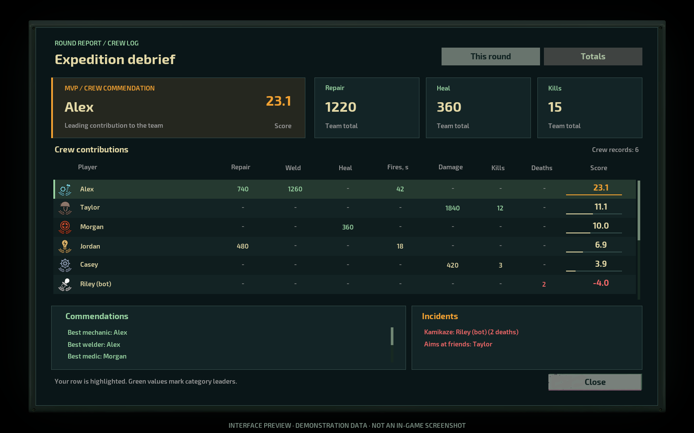

# Round Report

Barotrauma multiplayer mod (Lua). Tracks per-player stats each round and announces an MVP when the round ends.



*preview.png is a mockup, not an in-game screenshot.*

## What it tracks

Repairs, welding, healing (including CPR), fire extinguishing, damage dealt, kills, deaths, friendly fire and reactor meltdowns. The MVP score is the player's share of each team total, minus penalties for deaths and friendly fire. A reactor meltdown removes MVP eligibility.

## Features

- End-of-round report in chat for everyone.
- Optional report window (tabs: this round / totals) for players who have the client-side LuaCs patch. Players without it get chat lines.
- Chat commands: `!stats` (this round, all players), `!mystats` (only you), `!total` (since the server started).
- Ukrainian and English text, bots can be included or excluded. See `Lua/RoundReport/Config.lua`.
- Player stats survive renames and authenticated reconnects during the server's lifetime.
  Reconnecting without an account ID starts a new player record.

## Requirements

- Barotrauma 1.13.4.0
- [Lua For Barotrauma](https://github.com/evilfactory/LuaCsForBarotrauma) enabled on the host
- Multiplayer only. Stats come from server-side karma hooks, so there is nothing to report in single player. Stats live in memory and reset on a server restart.

## Install

Copy this folder into `<Steam>/steamapps/common/Barotrauma/LocalMods/RoundReport`. Enable it and Lua For Barotrauma in Settings -> Mods, then host a server. Use `reloadlua` in the server console to reload scripts.

When updating from the original name-based tracking, restart the server once to clear
legacy in-memory records. Subsequent `reloadlua` calls preserve the new player identities,
stats, and connected clients' window support.

## Status

Version 0.3.0. Logic is unit-tested against a mocked game API. **Not yet tested in a real game.**

## Tests

```
pip install lupa
python tests/test_roundreport.py .
python tests/test_roundreport_client.py .
python tests/test_player_identity.py
```
